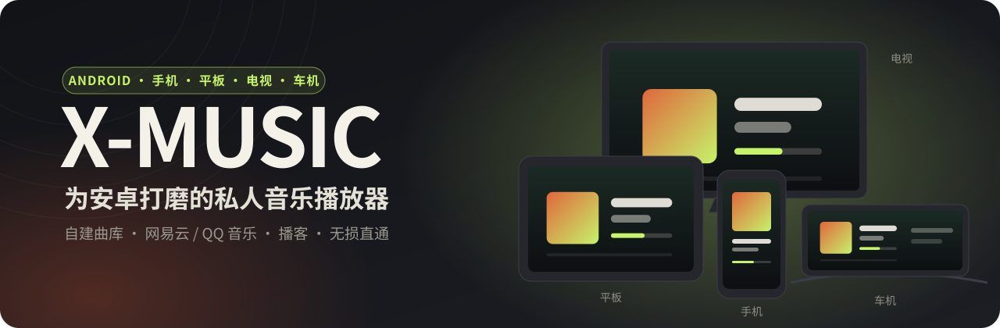
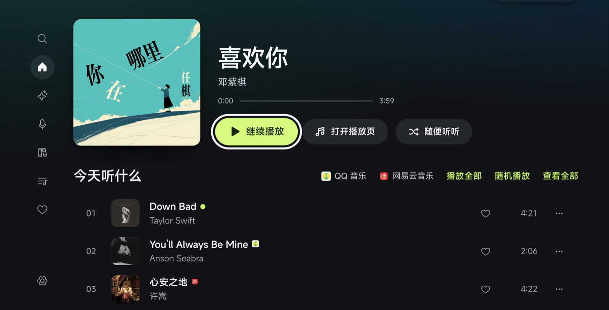
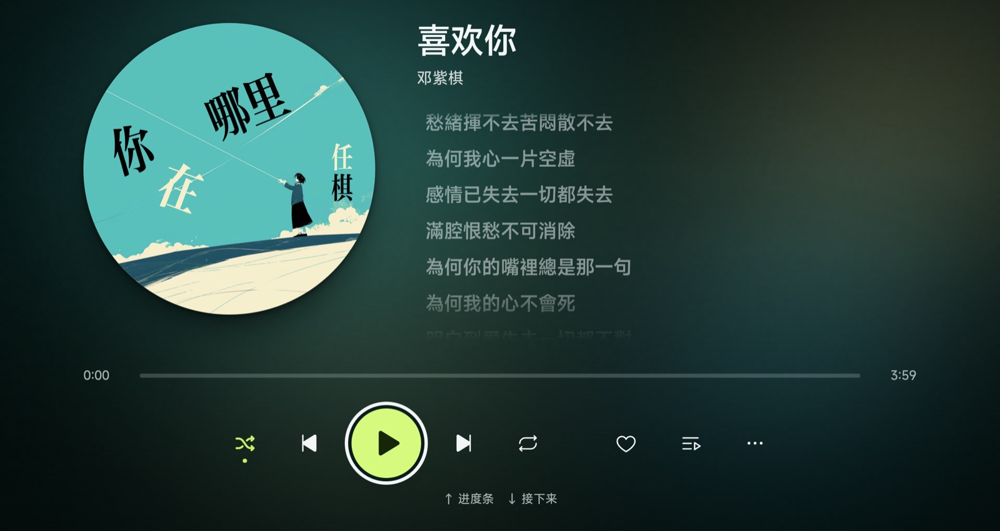
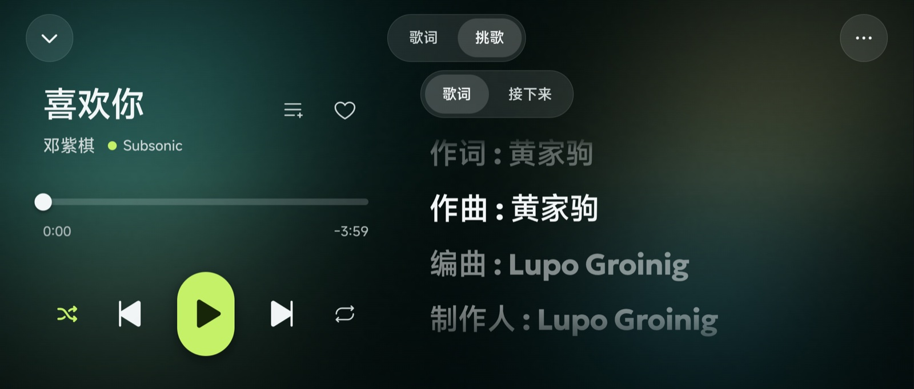
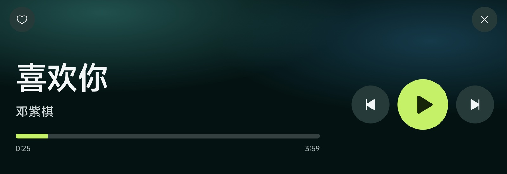

<div align="center">



<br/>

手机、平板、电视、车机，一个安装包全都适配。<br/>
连上自己 NAS 里的曲库，或者用自己的网易云 / QQ 音乐账号扫码登录，听你本来就有权听的歌。

[](https://github.com/guohaomin1995-dev/N1KO-MUSIC/releases/latest)
[](https://github.com/guohaomin1995-dev/N1KO-MUSIC/releases)
[](#-安装)
[](LICENSE)

**[⬇ 下载 APK](https://github.com/guohaomin1995-dev/N1KO-MUSIC/releases/latest)** ·
**[更新日志](https://github.com/guohaomin1995-dev/N1KO-MUSIC/releases)** ·
**[English](README_EN.md)**

</div>

<br/>

## ✦ 一个安装包，四块屏

同一个 App 在不同的屏幕上换不同的样子——不是把手机界面拉大，而是每种屏幕各有一套为它设计的布局和操作方式。

<table>
<tr>
<td width="50%" valign="top">

### 📱 手机

- 底部悬浮标签栏，单手够得着
- 播放页三种视图：**封面 / 歌词 / 接下来**；在封面上左右一划就切歌
- 横过来变成一叠大封面，左右甩着挑歌
- 通知栏、锁屏、有线耳机、蓝牙按键都能控制播放

</td>
<td width="50%" valign="top">

### 💻 平板

- 横屏是侧栏 + 正在播放面板，竖屏、分屏各有一套布局
- **天际屏风格的歌词页**：玻璃质感的字，唱到哪染到哪，两侧散落这一句里的字和它们的投影
- 界面和歌词页的颜色跟着封面走
- 外接键盘时，全套快捷键都能用

</td>
</tr>
<tr>
<td width="50%" valign="top">

### 📺 电视 · 电视盒子

- 自动认出安卓电视和电视盒子，切到**遥控器布局**
- 方向键能走到每一个按钮，选中的按钮放大、黑白反色，一眼看清在哪
- 左侧导航条，焦点移进去就展开；确认键打开，返回键退出
- 系统 WebView 老到 **Chrome 83** 的盒子也能正常显示

</td>
<td width="50%" valign="top">

### 🚗 车机

- **车载模式**：超大按钮、左右滑动切歌、屏幕常亮
- 兼容老内核车机：系统 WebView 不认新的颜色写法，深色模式照样清楚
- 横长的中控屏也排得开
- 方向盘和蓝牙的媒体按键能切歌、暂停

</td>
</tr>
</table>

<br/>

## ✦ 截图

<table>
<tr>
<td colspan="2"></td>
</tr>
<tr>
<td colspan="2" align="center"><sub><b>平板 · 天际屏风格歌词页</b>：烟雾、聚光灯、玻璃字，两侧散落这一句里的字</sub></td>
</tr>
<tr>
<td width="50%"></td>
<td width="50%"></td>
</tr>
<tr>
<td align="center"><sub><b>电视 · 首页</b>：焦点停在哪，一眼就能看到</sub></td>
<td align="center"><sub><b>电视 · 正在播放</b>：坐在沙发上也看得清</sub></td>
</tr>
<tr>
<td width="50%"></td>
<td width="50%"></td>
</tr>
<tr>
<td align="center"><sub><b>手机 · 横屏播放页</b>：左边控制，右边歌词</sub></td>
<td align="center"><sub><b>车机 · 车载模式</b>：开车时也按得准</sub></td>
</tr>
</table>

<br/>

## ✦ 能听什么

### 自己的曲库

| 来源 | 状态 | 说明 |
|---|---|---|
| [Navidrome](https://www.navidrome.org/) | ✅ 推荐 | 体验最好，测试最充分 |
| [Subsonic](http://www.subsonic.org/) / [Airsonic](https://airsonic.github.io/) | ✅ 支持 | 完整兼容 Subsonic API |
| [Jellyfin](https://jellyfin.org/) / [Emby](https://emby.media/) | ✅ 支持 | 原生 API 对接 |
| WebDAV | ✅ 支持 | 直接读 NAS 上的音乐文件夹，不用另装音乐服务器 |

分享、评分、断点续播、多音乐库、电台这些能力是**探测出来的**：你的服务器不支持哪一项，那个入口就不出现，而不是点了报错。
局域网里用 `http://` 地址的服务器也能直接连。

### 流媒体音源

没有 NAS，或者 NAS 上没有的歌，用你自己的账号登录就能听。

| 音源 | 登录 | 能做什么 |
|---|---|---|
| 网易云音乐 | 网易云 App 扫码 | 搜索、我的歌单、收藏、每日推荐、榜单、歌词、加入 / 移出歌单、播客 |
| QQ 音乐 | QQ / 微信扫码 | 搜索、我的歌单、收藏、雷达推荐、榜单、歌词 |
| 小宇宙 | 不用登录 | 播客：粘贴分享链接找节目，订阅存在本机 |

它们和自己的曲库**并列**：搜索按来源分组，首页的「今天听什么」把各家的每日推荐交错成一列，队列里可以混着放。

> **你有权听什么，这里就放什么。** 会员曲你的账号没权限，就标成 VIP 并告诉你原因，不做任何解析、破解。
> 这些接口来自社区整理，不是官方开放接口，平台一改可能失效，会跟着修，但不保证永远可用。

<br/>

## ✦ 听感与细节

- **无损直通**：FLAC / WAV / ALAC 原样播放；Wi-Fi 和移动网络分别设音质（无损 / 320 / 192 / 128 kbps），出门自动切
- **ReplayGain**：用服务器算好的增益，不同年代的母带不再忽大忽小
- **封面取色**：整个界面和全屏播放页跟着当前封面换颜色
- **歌词补全**：服务器没有歌词时，按歌名和歌手去歌词接口查
- **真正的全库随机**；队列放完自动接相似的歌
- **拔耳机立刻暂停**，一分钟内插回来接着放
- 睡眠定时渐弱、0.5–3 倍速、断点续播
- **应用内更新**：有新版本时 App 里直接下载、安装

<br/>

## ✦ 安装

在 **[Releases](https://github.com/guohaomin1995-dev/N1KO-MUSIC/releases/latest)** 下载 `X-MUSIC-x.y.z.apk`，支持 Android 7.0 及以上。

**手机 / 平板**：点开 APK 安装（第一次要允许「安装未知来源应用」）。以后有新版本，App 里会提示「下载更新」。

**电视 / 电视盒子**：U 盘拷进去用文件管理器安装，或者在电脑上用 adb：

```bash
adb connect 电视的IP:5555
```

```bash
adb install X-MUSIC-x.y.z.apk
```

打开后自动进入电视模式；**设置 → 电视模式**可以手动切换「自动 / 开 / 关」。

**车机**：把 APK 拷进 U 盘，用车机自带的文件管理器打开安装。开车时建议在设置里进入「车载模式」。

> GitHub 下载很慢或者下不下来，先打开代理（VPN）再试。

<details>
<summary><b>常见问题</b></summary>

<br/>

**安装时提示「与已安装的应用签名不一致」，装不上**
设备上装过别处打包的版本，签名不同，不能直接覆盖。先卸载旧的再装（会清掉这台设备上的登录和设置）：

```bash
adb uninstall cn.baogutang.musicstreampro
```

之后再升级就能直接覆盖，数据和登录都会保留。

**车机上深色模式白底白字、播放页的按钮黑成一片**
老内核 WebView 不认新的颜色写法，1.18.4 起已兜底。请升级到最新版。

**电视上扫码登录，二维码一直出不来**
多半装的是缺原生组件的改版安装包。卸载后装这里发布的 1.18.7 或更新版本。

**有的歌放不了，显示 VIP**
你的账号对这首歌没有播放权限。X-MUSIC 只放你的账号本来就能放的歌。

</details>

<br/>

## ✦ 隐私

| 什么 | 去了哪 |
|---|---|
| 你的音乐 | 你自己的服务器，以及你登录过的音源。没有别处。 |
| 服务器密码、音源登录凭据 | 用设备上取不出来的密钥加密，只存在本机。 |
| 收听历史、统计、口味画像 | 这台设备，以及你自己配置的同步服务（如果有）。 |
| 歌词 / 封面补全 | 服务器没有时，把歌名和歌手发给歌词接口（默认 lrc.cx，设置里可以改）。 |
| 检查更新 | 读本仓库 GitHub Releases 上的最新版本号。 |
| 埋点、统计、崩溃上报 | 没有。 |

<br/>

## ✦ 从源码构建

需要 Node.js 20 以上、JDK 21、Android SDK。

```bash
cd frontend
npm ci
npm run build:mobile
npx cap sync android
cd android && ./gradlew assembleRelease
```

改代码前后跑一遍 `npm test` 和 `npm run lint`。界面的设计约定（颜色 token、组件、动效）见 [`DESIGN.md`](DESIGN.md)。

<br/>

## ✦ 致谢

X-MUSIC 基于 **[baogutang/N1KO-MUSIC](https://github.com/baogutang/N1KO-MUSIC)**（MIT）开发：界面设计、插件协议和绝大部分功能都来自上游，这里专注把它在安卓手机、平板、电视、车机上做好。
吉祥物「糯米」和「毛豆」是上游作者的原创角色，形象版权归原作者所有，不随 MIT 许可授权。

也感谢 [Navidrome](https://www.navidrome.org/)、[StreamMusic](https://github.com/gitbobobo/StreamMusic)、[MusicBrainz](https://musicbrainz.org/)、[Capacitor](https://capacitorjs.com/) 这些项目。

## ✦ 许可

[MIT](LICENSE)
