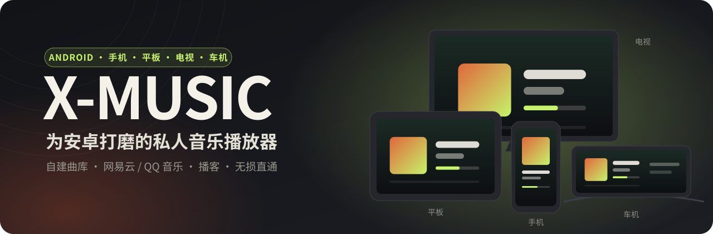
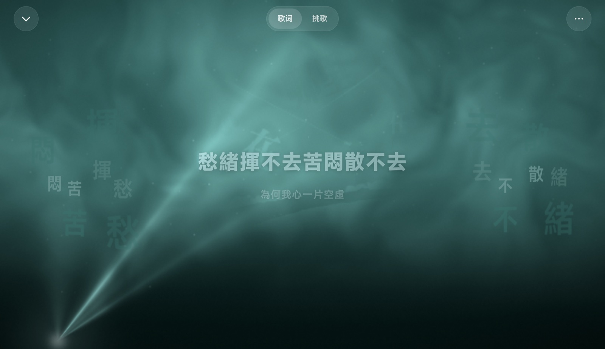
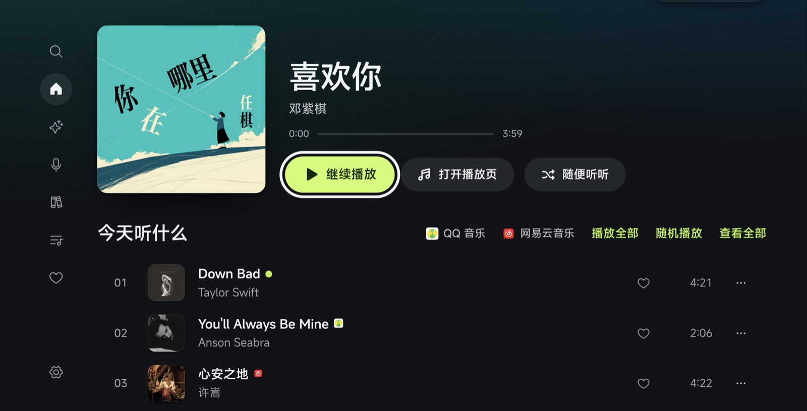
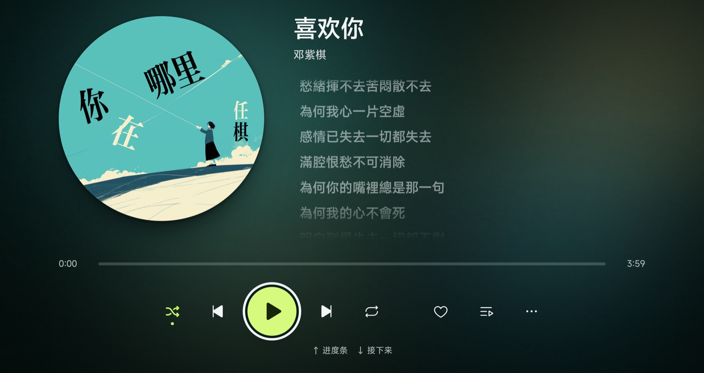
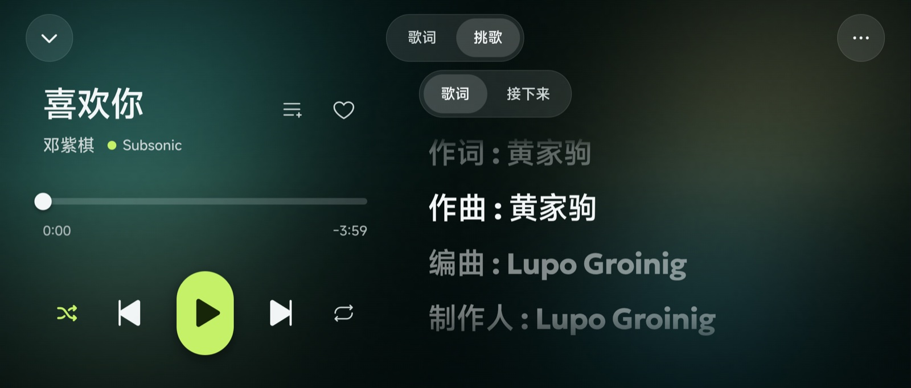
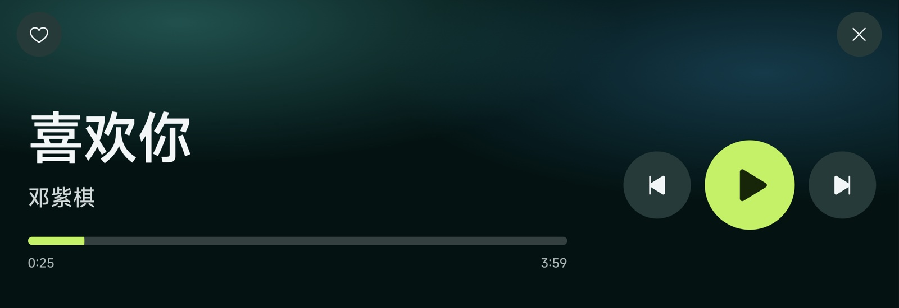

<div align="center">



<br/>

Phones, tablets, TVs and car head units, all from one APK.<br/>
Point it at the library on your own NAS, or sign in with your own NetEase Cloud Music / QQ Music account and play what that account can already play.

[](https://github.com/guohaomin1995-dev/N1KO-MUSIC/releases/latest)
[](https://github.com/guohaomin1995-dev/N1KO-MUSIC/releases)
[](#-install)
[](LICENSE)

**[⬇ Download the APK](https://github.com/guohaomin1995-dev/N1KO-MUSIC/releases/latest)** ·
**[Changelog](https://github.com/guohaomin1995-dev/N1KO-MUSIC/releases)** ·
**[中文](README.md)**

</div>

<br/>

## ✦ One APK, four screens

The same app takes a different shape on each screen. It is not the phone layout stretched out: every kind of screen gets a layout and a way of operating designed for it.

<table>
<tr>
<td width="50%" valign="top">

### 📱 Phone

- A floating tab bar at the bottom, within thumb reach
- Three views in Now Playing: **Cover / Lyrics / Up Next**; swipe the cover to change track
- Turn it sideways and Now Playing becomes a stack of large covers you flick through
- The notification, lock screen, wired headsets and Bluetooth buttons all control playback

</td>
<td width="50%" valign="top">

### 💻 Tablet

- Landscape gets a sidebar plus a Now Playing panel; portrait and split screen get their own layouts
- **Sky-screen style lyrics**: frosted-glass text that fills in as it is sung, with words from the line scattered on both sides and casting shadows
- The interface and the lyrics page take their colour from the cover
- With a keyboard attached, every shortcut works

</td>
</tr>
<tr>
<td width="50%" valign="top">

### 📺 TV and TV boxes

- Recognises Android TVs and TV boxes and switches to a **remote-control layout**
- The D-pad reaches every button; the focused one grows and inverts, so you always know where you are
- A navigation rail on the left that opens when focus moves into it; OK opens, Back exits
- **Lyrics screensaver**: eight seconds without a key press while music plays turns the screen into full-screen sky-screen lyrics; any key brings it back
- Works on boxes whose system WebView is as old as **Chrome 83**

</td>
<td width="50%" valign="top">

### 🚗 Car

- **Car mode**: oversized buttons, swipe to change track, screen kept on
- Works on old head units whose WebView does not understand modern colour syntax; dark mode stays readable
- Wide, short centre screens have room to breathe
- Steering-wheel and Bluetooth media buttons skip and pause

</td>
</tr>
</table>

<br/>

## ✦ Screenshots

<table>
<tr>
<td colspan="2"></td>
</tr>
<tr>
<td colspan="2" align="center"><sub><b>Tablet · sky-screen lyrics</b>: smoke, a spotlight, glass text and the words of the line scattered on both sides</sub></td>
</tr>
<tr>
<td width="50%"></td>
<td width="50%"></td>
</tr>
<tr>
<td align="center"><sub><b>TV · Home</b>: you can always see where focus is</sub></td>
<td align="center"><sub><b>TV · Now Playing</b>: readable from the sofa</sub></td>
</tr>
<tr>
<td width="50%"></td>
<td width="50%"></td>
</tr>
<tr>
<td align="center"><sub><b>Phone · landscape player</b>: controls on the left, lyrics on the right</sub></td>
<td align="center"><sub><b>Car · Car mode</b>: easy to hit while driving</sub></td>
</tr>
</table>

<br/>

## ✦ What it plays

### Your own library

| Source | Status | Notes |
|---|---|---|
| [Navidrome](https://www.navidrome.org/) | ✅ Recommended | Best experience, most tested |
| [Subsonic](http://www.subsonic.org/) / [Airsonic](https://airsonic.github.io/) | ✅ Supported | Full Subsonic API |
| [Jellyfin](https://jellyfin.org/) / [Emby](https://emby.media/) | ✅ Supported | Native API |
| WebDAV | ✅ Supported | Reads the music folders on your NAS directly, no music server needed |

Sharing, ratings, bookmarks, multiple libraries and radio are **detected, not assumed**: if your server does not support one, its entry does not appear at all instead of failing when tapped.
Servers on your LAN at plain `http://` addresses connect fine.

### Streaming sources

No NAS, or a song your NAS does not have? Sign in with your own account.

| Source | Sign-in | What it can do |
|---|---|---|
| NetEase Cloud Music | Scan with the NetEase app | Search, your playlists, favourites, daily picks, charts, lyrics, add to / remove from playlists, podcasts |
| QQ Music | Scan with QQ or WeChat | Search, your playlists, favourites, radar picks, charts, lyrics |
| Xiaoyuzhou | None | Podcasts: paste a share link to find a show, subscriptions stay on the device |

They sit **alongside** your own library: search groups results by source, the home page's "Today" list interleaves every source's daily picks, and one queue can mix them.

> **It plays what your account is entitled to play.** A members-only track your account cannot play is marked VIP with the reason; nothing is cracked or unlocked.
> These APIs are community-documented, not official. A platform change can break them; they get fixed when that happens, but there is no guarantee.

<br/>

## ✦ Sound and details

- **Lossless passthrough**: FLAC / WAV / ALAC play untouched; quality is set separately for Wi-Fi and mobile data (lossless / 320 / 192 / 128 kbps) and switches automatically
- **ReplayGain** uses the gain your server already computed
- **Colour from the cover**: the whole interface and the full-screen player follow the current cover
- **Lyrics fallback**: when the server has none, they are looked up by title and artist
- **True whole-library shuffle**; when the queue runs out, similar songs follow
- **Unplugging headphones pauses at once**; plug them back within a minute and it carries on
- Sleep timer with fade-out, 0.5–3× speed, resume where you left off
- **In-app updates**: new versions download and install from inside the app

<br/>

## ✦ Install

Download `X-MUSIC-x.y.z.apk` from **[Releases](https://github.com/guohaomin1995-dev/N1KO-MUSIC/releases/latest)**. Android 7.0 or later.

**Phone / tablet**: open the APK to install (the first time, allow installing apps from unknown sources). Later versions are offered inside the app.

**TV / TV box**: copy it over on a USB stick and open it in a file manager, or use adb from a computer:

```bash
adb connect <tv-ip>:5555
```

```bash
adb install X-MUSIC-x.y.z.apk
```

It opens in TV mode by itself; **Settings → TV mode** switches between Auto / On / Off.

**Car**: copy the APK to a USB stick and open it with the head unit's file manager. Car mode in Settings is recommended while driving.

<details>
<summary><b>FAQ</b></summary>

<br/>

**Install fails with "signatures do not match the installed app"**
A build packaged elsewhere is installed and its signature differs. Uninstall it first (this clears sign-ins and settings on that device):

```bash
adb uninstall cn.baogutang.musicstreampro
```

After that, updates install over the top and keep your data.

**Dark mode is white-on-white in the car, or the player buttons are solid black**
Old WebViews do not understand the modern colour syntax; there is a fallback since 1.18.4. Update to the latest version.

**The sign-in QR code never appears on the TV**
Usually a repackaged build missing native components is installed. Uninstall it and install 1.18.7 or later from here.

**Some songs will not play and show VIP**
Your account has no right to play that track. X-MUSIC only plays what your account can already play.

</details>

<br/>

## ✦ Privacy

| What | Where it goes |
|---|---|
| Your music | Your own server and the sources you signed in to. Nowhere else. |
| Server passwords, source sign-ins | Encrypted with a key that cannot be read out of the device, stored only on it. |
| Listening history, stats, taste profile | This device, and your own sync service if you set one up. |
| Lyrics / cover fallback | When the server has none, title and artist go to a lyrics API (lrc.cx by default; configurable in Settings). |
| Update check | Reads the latest version from this repository's GitHub Releases. |
| Analytics, telemetry, crash reports | None. |

<br/>

## ✦ Build from source

Requires Node.js 20+, JDK 21 and the Android SDK.

```bash
cd frontend
npm ci
npm run build:mobile
npx cap sync android
cd android && ./gradlew assembleRelease
```

Run `npm test` and `npm run lint` before and after changes. The design contract (colour tokens, components, motion) is in [`DESIGN.md`](DESIGN.md).

<br/>

## ✦ Credits

X-MUSIC is built on **[baogutang/N1KO-MUSIC](https://github.com/baogutang/N1KO-MUSIC)** (MIT): the interface design, the plugin protocol and most features come from upstream; this fork focuses on making it right on Android phones, tablets, TVs and cars.
The mascots Nuomi and Maodou are the upstream author's own characters; their likeness belongs to the author and is not licensed under MIT.

Thanks also to [Navidrome](https://www.navidrome.org/), [StreamMusic](https://github.com/gitbobobo/StreamMusic), [MusicBrainz](https://musicbrainz.org/) and [Capacitor](https://capacitorjs.com/).

## ✦ License

[MIT](LICENSE)
